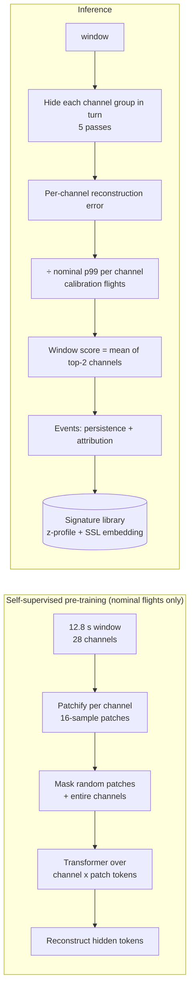
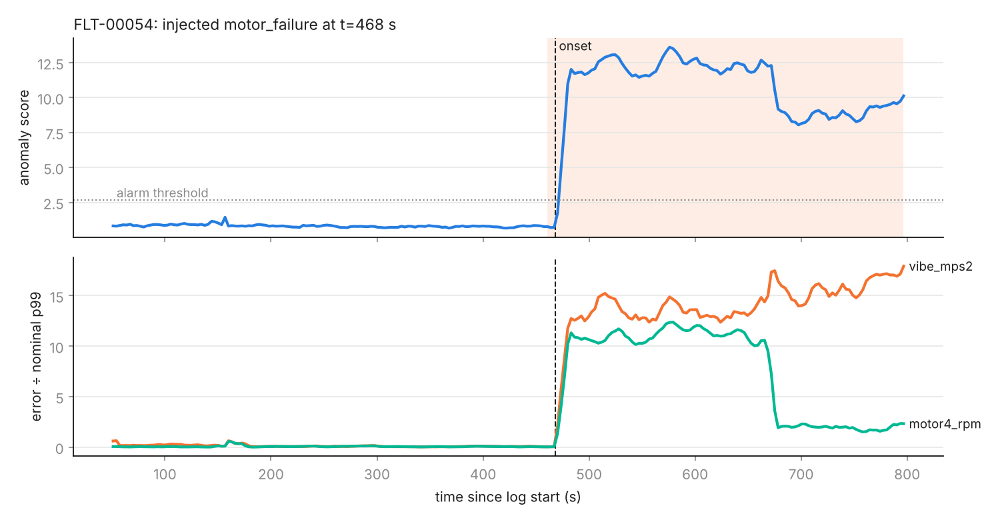

# aerosig 🛩️📈

**Self-supervised fault detection and a fault-signature library for flight telemetry.** A cross-channel PatchTST-style Transformer learns how an aircraft's sensors *relate to each other* from nominal flights only. Faults show up as channels that the rest of the aircraft state can no longer explain. You get detection, per-channel attribution, and a searchable library of what each failure mode looks like. No fault labels are needed to train the detector.

> Built on [flightlake](https://github.com//flightlake), which provides the data and the hybrid-electric STOL simulator with ground-truth fault injection.

## The idea



Classic PatchTST is **channel-independent**: each sensor is modelled on its own. That catches transients, but a *persistent* fault looks normal once you are inside it, because a motor reading 0 rpm is perfectly predictable from its own past. aerosig adds **channel tokens and whole-channel masking**. During pre-training the model must rebuild, say, `motor3_rpm` from throttle, the other motors, battery current and attitude, so it learns the aircraft's physics. At inference each channel is hidden in turn. A channel that disagrees with what the rest of the aircraft implies gets a high error, which gives a detection *and* an explanation at once.

- **Training data:** nominal flights only (`injected_faults == none` on the test card), the way a real fleet learns "normal" from sorties that were signed off.
- **Calibration:** the threshold is set from a held-out quantile of *nominal* flights. Faulty flights are never used to train or tune the detector.
- **Scope:** windows that lie fully within airborne phases. Rotation and flare are separate regimes with their own monitors.
- **Score normalization:** each channel's reconstruction error is divided by its nominal 99th percentile, and the window score is the mean of the top two channels. A log-error robust z-score was tried first, but its heavy nominal tails pushed the threshold so high that persistent single-channel faults (a stopped motor) were missed. The choice was made on the *library/dev* split (recall 0.85 vs 0.38), not on the test split.
- **Streaming latency:** a detection is time-stamped at the *end* of the second consecutive anomalous window, which is when an online monitor could actually raise it.



## Results (reference fleet: 300 sorties; test = 103 injected faults + 19 held-out nominal flights)

Event-level, identical windowing, thresholding (nominal 99.8th percentile) and persistence rules for every method:

| Detector | Fault recall | Median detection latency | False alarms / flight-hour | Event precision |
|---|---|---|---|---|
| Robust z-score on window means (fleet stats) | 0.330 | 31.85 s | 0.0 | 1.0 |
| Isolation Forest on window mean/std | 0.233 | 20.25 s | 0.222 | 0.889 |
| **aerosig cross-channel SSL Transformer** | **0.942** | **8.7 s** | **0.222** | **0.97** |

Per fault type (aerosig):

| Fault | n | Recall | Median latency |
|---|---|---|---|
| `battery_degradation` | 17 | 0.65 | 64.3 s |
| `elevator_stuck` | 14 | 1.00 | 24.8 s |
| `generator_dropout` | 14 | 1.00 | 50.4 s |
| `gnss_jamming` | 16 | 1.00 | 4.8 s |
| `gnss_spoofing` | 13 | 1.00 | 5.7 s |
| `imu_vibration` | 10 | 1.00 | 5.5 s |
| `motor_failure` | 7 | 1.00 | 8.4 s |
| `pitot_blockage` | 12 | 1.00 | 10.3 s |

**Fault-signature matching.** Signatures come from library flights (the first minute after a labeled onset). Test signatures come from *detections* only. Matching uses k-NN:

| Signature representation | Accuracy | Macro-F1 |
|---|---|---|
| per-channel z-profile (interpretable) | 0.938 | 0.936 |
| SSL embedding (PCA-16) | 0.928 | 0.930 |
| combined | 0.948 | 0.945 |

Unsupervised clustering of library signatures vs. true fault type: ARI = 0.668.

**Learned signature cards** (mean channel z in the first minute, top channels): this is what an engineer reads:

| Fault | Top channels (error ÷ nominal p99) |
|---|---|
| `battery_degradation` | batt_v 2.6, ekf_pos_innov_m 0.8, ekf_hacc_m 0.7, ekf_vel_innov_mps 0.7 |
| `elevator_stuck` | elevator_cmd_deg 2.2, roll_deg 1.3, ekf_pos_innov_m 0.8, ekf_vel_innov_mps 0.7 |
| `generator_dropout` | gen_kw 5.0, batt_v 1.3, batt_a 1.2, ekf_pos_innov_m 0.8 |
| `gnss_jamming` | ekf_hacc_m 96.0, gnss_hdop 84.8, gnss_nsat 28.9, r_dps 4.4 |
| `gnss_spoofing` | ekf_pos_innov_m 101.1, ekf_vel_innov_mps 81.1, r_dps 4.9, roll_deg 4.2 |
| `imu_vibration` | vibe_mps2 101.4, ax_mps2 4.4, az_mps2 3.6, roll_deg 3.2 |
| `motor_failure` | vibe_mps2 11.9, motor1_rpm 7.7, motor2_rpm 6.7, motor3_rpm 2.1 |
| `pitot_blockage` | airspeed_mps 11.9, throttle 1.7, motor2_rpm 1.6, motor4_rpm 1.6 |

> Honest limits: training ran for 8 epochs (26 min) on 2 CPU cores with 12 k windows. The hardest class is battery degradation (recall 0.65, slow): a weak pack hides behind the generator in cruise and only shows under load. Generator dropout is always caught, but the median latency is 50 s, because the battery absorbs the load smoothly. Next steps are more epochs on a GPU, phase-conditioned calibration, and longer windows for slow power faults. The simulator, the splits and every number above are reproduced by `make all`.

## Quickstart

```bash
pip install -e ".[dev,onnx]"        # pulls flightlake
make data                            # 300 simulated sorties -> data/lake
aerosig score FLT-00054 --art pretrained   # use the checked-in model (trained on this exact seeded fleet)
make train evaluate signatures onnx  # or retrain: ~30 min CPU, minutes on a GPU
aerosig score FLT-00054              # events with top contributing channels
```
Example output for one event:
```json
{"t_start": 460.8, "t_detect": 476.7, "t_end": 796.7, "peak_score": 13.61, "phase_at_detect": "cruise",
 "top_channels": {"vibe_mps2": 10.29, "motor4_rpm": 8.65, "ekf_pos_innov_m": 0.79, "gnss_hdop": 0.75, "ekf_vel_innov_mps": 0.72}}
```
The test card for FLT-00054 says motor 4 failed at t = 468.3 s. Detection came 8.4 s later, and motor 4 was correctly attributed.

## Deployment

- **REST:** `aerosig serve` or the Docker image runs `GET /score/{flight_id}`, which returns events plus attribution. The agent in `flight-investigator-agent` can call it as a tool.
- **Edge / ground station:** `aerosig export-onnx` writes `artifacts/aerosig.onnx` (dynamic batch, parity-checked with onnxruntime) for C++ or onnxruntime on the ground-station laptop or a companion computer.
- **Batch:** score every new sortie from the flightlake Airflow DAG and write events to `lake/events/`. The Streamlit explorer in `aerolabel` overlays them (`AEROSIG_EVENTS=artifacts/per_flight_events.json`).
- **Real data:** point `aerosig train --lake` at a lake built from real PX4 ULogs, or from the CMU ALFA fault dataset via the flightlake CSV adapter. The feature list in `data.py` is the only airframe-specific part.

## Layout
```
src/aerosig/
  data.py        # features, robust normalizer, windows, airborne eligibility, leakage-safe splits
  model.py       # CrossChannelPatchTST, mixed temporal+channel masking, inference channel groups
  train.py       # SSL pre-training + nominal-only threshold calibration
  score.py       # per-channel z, window score, persistent events with attribution
  evaluate.py    # event-level recall / latency / false alarms per hour; z-score & IsolationForest baselines
  signatures.py  # signature library, k-NN matching, clustering ARI, signature cards
  export.py      # ONNX export + parity check
  service.py     # FastAPI scoring service
```

MIT licensed.
